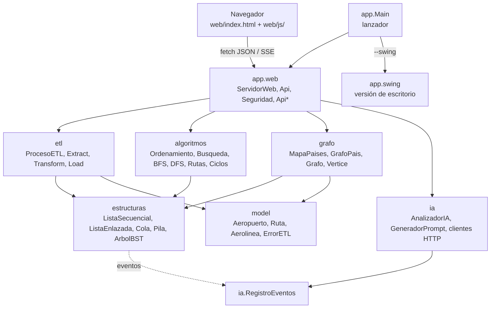
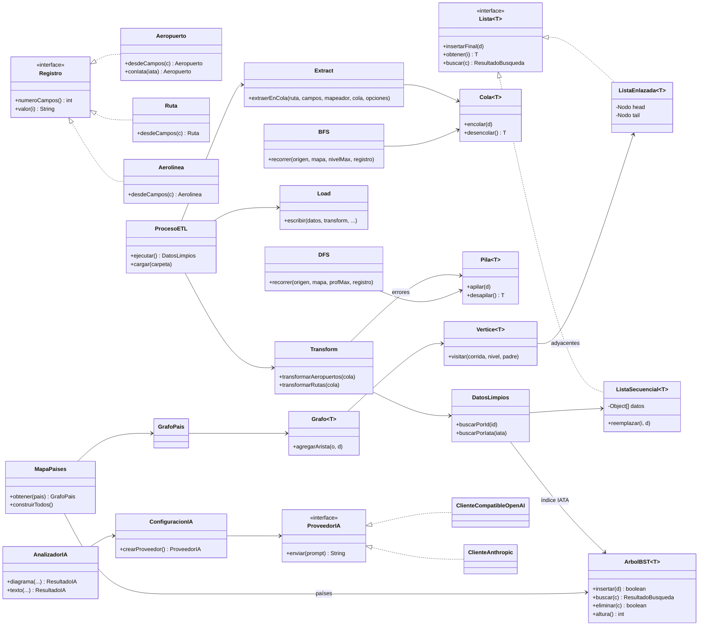
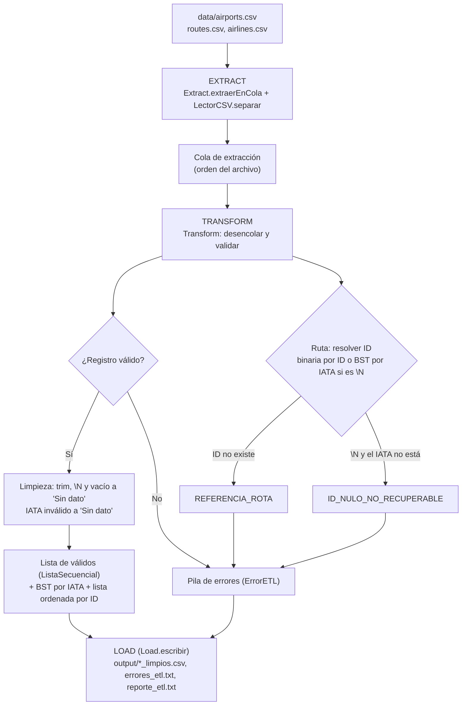

# SmartETL-DS + IA


Proyecto final integrador de **Estructura de Datos**. Toma los datos públicos de aeropuertos, rutas y aerolíneas de **OpenFlights**, los limpia con un proceso **ETL** construido con **estructuras de datos propias** (listas, cola, pila, árbol binario de búsqueda y grafo) y los muestra en una **interfaz web local** servida por el mismo programa Java. Una **capa de IA** genera flujogramas y explicaciones a partir de lo que el programa realmente hizo al ejecutarse.

**Objetivo:** aplicar cada estructura de datos donde tiene sentido usarla, medir su costo (comparaciones, tiempos) y poder explicar el porqué de cada decisión.

Repositorio: https://github.com/juanchicoyunda1234/SmartETL-Final  
Diapositivas: https://www.canva.com/design/DAHbC7PRlh4/mN95lvB90CkdKloMjkXChA/view

---

## Contenido

1. [Equipo y asignatura](#1-equipo-y-asignatura)
2. [Qué hace](#2-qué-hace)
3. [Estructuras de datos y por qué](#3-estructuras-de-datos-y-por-qué)
4. [Arquitectura por capas](#4-arquitectura-por-capas)
5. [Diagrama de clases](#5-diagrama-de-clases)
6. [Flujo del ETL](#6-flujo-del-etl)
7. [Requisitos, instalación y ejecución](#7-requisitos-instalación-y-ejecución)
8. [Configurar las API keys de IA](#8-configurar-las-api-keys-de-ia)
9. [Dataset](#9-dataset)
10. [Pruebas](#10-pruebas)
11. [Documentación, capturas y diapositivas](#11-documentación-capturas-y-diapositivas)
12. [Flujo de trabajo del equipo](#12-flujo-de-trabajo-del-equipo)

---

## 1. Equipo y asignatura

| Integrante | Usuario GitHub | Rol en el proyecto |
|---|---|---|
| Juan Carlos Chico (líder) | [@juanchicoyunda1234](https://github.com/juanchicoyunda1234) | Esqueleto del repositorio, seguridad, grafo (general y por país, BFS por niveles, DFS, ruta y ciclo), integración final y README |
| Jeremy Torosina | [@WinoSpop](https://github.com/WinoSpop) | Datos: dataset OpenFlights, lectura de CSV y modelo |
| Noemi Tuza | [@edithtuza15-collab](https://github.com/edithtuza15-collab) | ETL: cola de extracción, limpieza de `\N`, pila de errores, referencia rota frente a ID nulo no recuperable |
| Andres Llamuca | [@llamucaandres161](https://github.com/llamucaandres161) | Búsqueda y BST |
| Joseph Romo | [@wayusa25-cmyk](https://github.com/wayusa25-cmyk) | Búsqueda y BST, capa web (servidor y frontend) |
| Jullisa Altamirano | [@jullisaaltamirano2017-boop](https://github.com/jullisaaltamirano2017-boop) | IA: API keys, proveedores, prompt con Mermaid |

| Asignatura | Dato |
|---|---|
| Universidad | Universidad Técnica de Ambato (UTA) |
| Facultad | Facultad de Ingeniería en Sistemas, Electrónica e Industrial (FISEI) |
| Carrera | Software |
| Nivel y paralelo | Nivel III, paralelo B |
| Asignatura | Estructura de Datos |
| Docente | Ing. José Rubén Caiza |

---

## 2. Qué hace

| Pestaña web | Qué muestra |
|---|---|
| **Datos** | Carga cruda de un CSV en una lista enlazada o secuencial (todos, primeros N, rango o aleatorio), tabla paginada, buscar y filtrar |
| **ETL** | Pipeline en vivo: Extract → Cola → Transform → Lista de válidos / Pila de errores → Load, con KPIs, gráficos, la pila de errores por tipo y los archivos limpios de `output/` |
| **Estructuras** | Burbuja frente a inserción (con un visualizador paso a paso validado contra Java), búsqueda secuencial, binaria y por BST con el mismo código IATA, operaciones del BST, recorridos y desbalance |
| **Grafo** | Un grafo dirigido por país: conexiones de un aeropuerto, BFS por niveles, DFS, ruta más corta en vuelos, detección de ciclos, diagrama general y visor interactivo |
| **IA** | Flujogramas Mermaid y explicaciones con Gemini, Claude, OpenAI, GLM o GitHub Models, con respaldo local sin internet, comprobación de coherencia y evidencias |
| **Reporte** | Hoja A4 con lo ejecutado en la sesión, lista para guardar como PDF |

Cifras que reproduce el sistema con los datos reales (verificadas por las pruebas):

| Concepto | Valor |
|---|---|
| Aeropuertos, rutas y aerolíneas válidos | 7.698, 67.074 y 6.162 |
| Rutas con error | 589 (473 `REFERENCIA_ROTA`, 116 `ID_NULO_NO_RECUPERABLE`) |
| Buscar `UIO`: lista enlazada, binaria, BST | 2.556, 13 y 13 comparaciones |
| BST por IATA | 6.071 nodos, altura 177 |
| BST por ID con 1.500 claves ordenadas (desbalance) | altura 1.499 |
| Grafos por país | 225 países con aeropuertos, 3.264 vértices, 17.587 aristas internas |
| BFS mundial desde UIO | 3.217 aeropuertos en 8 niveles |
| Ruta UIO → CUZ | 2 vuelos (vía LIM) |

---

## 3. Estructuras de datos y por qué

Todas son **propias**, están en `src/estructuras/` y `src/grafo/`, y no se usa `ArrayList`, `HashMap`, `Stack` ni `LinkedList` de Java.

| Estructura | Clase | Dónde se usa | Por qué se eligió |
|---|---|---|---|
| **Lista secuencial** (arreglo que duplica su capacidad) | `src/estructuras/ListaSecuencial.java` | Listas de válidos del ETL, lista ordenada por ID, resultados de ordenamiento, paginación | `obtener(i)` es O(1): lo necesitan la búsqueda binaria, los ordenamientos y la paginación |
| **Lista enlazada** (`head` y `tail`) | `src/estructuras/ListaEnlazada.java` | Carga del Hito 1, búsqueda secuencial, adyacencias y vértices del grafo, registro de eventos | Insertar al final es O(1) sin redimensionar; ideal para listas que solo crecen y se recorren de inicio a fin |
| **Cola** (FIFO) | `src/estructuras/Cola.java` | Extract → Transform, BFS, ruta más corta, altura del BST | Conserva el orden del archivo (el número de línea de cada error es real) y es lo que pide BFS para visitar por capas |
| **Pila** (LIFO) | `src/estructuras/Pila.java` | Pila de errores del ETL, DFS, reconstruir rutas y ciclos | El último error queda arriba; DFS profundiza en el último vecino apilado; invertir un camino de destino a origen es apilar y desapilar |
| **Árbol binario de búsqueda** | `src/estructuras/ArbolBST.java` | IDs duplicados en Transform, índice por IATA, BST de países | Buscar cuesta O(h) en lugar de O(n): 13 comparaciones frente a 2.556 para UIO. Insertar, buscar y eliminar son iterativos para no desbordar la pila de llamadas con árboles degenerados |
| **Grafo dirigido** (lista de adyacencia) | `src/grafo/Vertice.java`, `Grafo.java`, `GrafoPais.java`, `MapaPaises.java` | Un grafo por país, construido bajo demanda | **Dirigido** porque una ruta UIO → BOG no implica que exista BOG → UIO; la arista va de origen a destino (`Grafo.agregarArista`). **Lista de adyacencia** porque el grafo es disperso (3.264 vértices y 17.587 aristas): una matriz desperdiciaría memoria |

Reutilización: la **cola** sirve al Extract y al BFS; la **pila**, a los errores, al DFS y a reconstruir caminos; la **lista enlazada**, a las adyacencias y al registro de eventos; el **BST**, al índice por IATA, a los duplicados por ID y al mapa de países.

---

## 4. Arquitectura por capas



```
SmartETL_DS-main/
├── src/
│   ├── model/          Aeropuerto, Ruta, Aerolinea, Registro, ErrorETL, TipoError
│   ├── estructuras/    Lista, ListaSecuencial, ListaEnlazada, Nodo, Cola, Pila, ArbolBST, NodoArbol, Criterio, ResultadoBusqueda
│   ├── etl/            LectorCSV, Extract, Transform, DatosLimpios, Load, ProcesoETL, FuenteDatos, OpcionesCarga, Proyecto…
│   ├── algoritmos/     Ordenamiento, Busqueda, Comparadores, BFS, DFS, Rutas, Ciclos, Vecinos…
│   ├── grafo/          Vertice, Grafo, GrafoPais, MapaPaises, Agrupacion
│   ├── ia/             ConfiguracionIA, ClienteCompatibleOpenAI, ClienteAnthropic, AnalizadorIA, GeneradorPrompt,
│   │                   GeneradorFlujogramaLocal, RegistroEventos, VisorHtml, VisorGrafo, AlmacenApis…
│   ├── app/            Main (web o --swing) y Sesion
│   │   ├── web/        Servidor HTTP local y endpoints JSON
│   │   └── swing/      Interfaz de escritorio anterior
│   └── pruebas/        PruebasHito1 a PruebasHito4 y PruebasIA
├── web/                index.html, hojas de estilo y js/ (una por pestaña)
├── recursos/           Librerías del frontend (sin CDN), iconos/, logos/, licencias/
├── data/               airports.csv, routes.csv, airlines.csv, FUENTE.txt, demo/
├── diagramas/          Diagramas .md y páginas .html generadas
├── evidencias_ia/      Prompt y respuesta de cada llamada a la IA
├── output/             Archivos limpios del Load (no se versionan)
├── docs/               Guías y documentación (ver sección 11)
├── .env.example        Nombres de las variables de entorno de IA (vacías)
└── README.md
```

---

## 5. Diagrama de clases

Clases principales y sus relaciones. El diagrama detallado del Hito 1 (modelo y listas) está en [`diagramas/Diagrama.md`](diagramas/Diagrama.md).



---

## 6. Flujo del ETL



Detalle de las reglas por fuente en `src/etl/Transform.java`: `validarAeropuerto`, `validarObligatoriosRuta`, `resolverId`, `errorDeExtremo` y `limpio`.

---

## 7. Requisitos, instalación y ejecución

**Requisitos**

- JDK 11 o superior. Comprobar con `java -version` y `javac -version`.
- Un navegador moderno (Chrome, Edge o Firefox).
- No hace falta Maven, Gradle ni internet: las librerías del frontend están en `recursos/`.

**1. Clonar**

```bash
git clone https://github.com/juanchicoyunda1234/SmartETL-Final.git
```

Entrar a la carpeta clonada (la que contiene `src/`, `web/` y `data/`).

**2. Compilar** (desde la raíz del proyecto)

Windows (cmd):

```bash
javac -encoding UTF-8 -d out src\model\*.java src\estructuras\*.java src\etl\*.java src\algoritmos\*.java src\grafo\*.java src\ia\*.java src\app\*.java src\app\swing\*.java src\app\web\*.java src\pruebas\*.java
```

Linux, macOS o Git Bash:

```bash
javac -encoding UTF-8 -d out $(find src -name "*.java")
```

**3. Ejecutar**

```bash
java -cp out app.Main
```

- Levanta el servidor web en **http://127.0.0.1:7070**. Si ese puerto está ocupado, prueba del 7071 al 7079.
- Abre el navegador automáticamente. Si no se abre, copiar en el navegador la dirección que muestra la consola.
- Si no encuentra `data/airports.csv`, pide elegir la carpeta del proyecto.
- **No cerrar la consola** mientras se usa la aplicación. Para detenerla: cerrar la consola o pulsar `Ctrl+C`.

Versión de escritorio anterior (Swing):

```bash
java -cp out app.Main --swing
```

**IntelliJ IDEA o VS Code:** abrir la carpeta, configurar un JDK 11+ y ejecutar `src/app/Main.java` (con `--swing` en los argumentos para la versión de escritorio).

---

## 8. Configurar las API keys de IA

La IA es **opcional**: en modo **"Solo local"** todo funciona sin llave y sin internet (los diagramas los genera `GeneradorFlujogramaLocal`).

| Proveedor | Variable de entorno | Dónde se obtiene la llave | Modelo (ejemplo) |
|---|---|---|---|
| Gemini | `GEMINI_API_KEY` | Google AI Studio: https://aistudio.google.com/apikey | `gemini-2.5-flash` |
| Claude | `ANTHROPIC_API_KEY` | Consola de Anthropic: https://console.anthropic.com/ | según la documentación de Anthropic |
| OpenAI | `OPENAI_API_KEY` | https://platform.openai.com/api-keys | según la documentación de OpenAI |
| GLM | `GLM_API_KEY` | Plataforma de Z.ai: https://z.ai (si la llave es de la plataforma de China, usar la URL `https://open.bigmodel.cn/api/paas/v4/chat/completions`) | según la documentación de Z.ai |
| GitHub Models | `GITHUB_TOKEN` | Token personal de GitHub con permiso `models:read`: https://github.com/settings/tokens | `openai/gpt-4.1-mini` |

Tres formas de darle la llave a la aplicación:

1. **Variable de entorno** antes de ejecutar, en la misma consola. Windows (cmd), cambiando `tu-llave` por la tuya:
   ```bash
   set GEMINI_API_KEY=tu-llave
   ```
   Linux o macOS:
   ```bash
   export GEMINI_API_KEY=tu-llave
   ```
   `.env.example` lista los nombres de todas las variables. La aplicación **no lee un archivo `.env`**: lee las variables del sistema o de la consola.
2. **Pestaña IA:** elegir el proveedor, escribir el modelo, pegar la llave y pulsar **Validar API**. La llave viaja una sola vez al servidor local y queda solo en su memoria; ningún endpoint la devuelve al navegador.
3. **Gestionar APIs** (dentro de la pestaña IA): guarda configuraciones con nombre en `~/.smartetl/apis.properties`, en la carpeta del usuario y **fuera del repositorio**. Se guarda en texto plano: no compartir ese archivo.

**Las llaves nunca se suben al repositorio.** El `.gitignore` excluye `.env`, `.env.*`, `apis.properties`, `.smartetl/`, `*.keys` y `*.pem`. Además, la aplicación no escribe llaves en `evidencias_ia/`, en los diagramas ni en el HTML (`PruebasIA` lo verifica).

---

## 9. Dataset

- **Fuente:** OpenFlights, https://openflights.org/data.php (repositorio: https://github.com/jpatokal/openflights). La descarga está registrada en [`data/FUENTE.txt`](data/FUENTE.txt).
- **Licencia:** las bases de aeropuertos, aerolíneas y rutas de OpenFlights se publican bajo la [Open Database License (ODbL) 1.0](https://opendatacommons.org/licenses/odbl/1-0/), y su contenido individual bajo la [Database Contents License (DbCL) 1.0](https://opendatacommons.org/licenses/dbcl/1-0/). Se permite usarlas citando la fuente y publicando con una licencia libre cualquier obra derivada que se haga pública.
- **Antigüedad:** según OpenFlights, los datos de rutas provienen de Airline Route Mapper y dejaron de actualizarse en junio de 2014: tienen valor histórico.

| Archivo | Filas | Campos | Uso |
|---|---|---|---|
| `data/airports.csv` | 7.698 | 14 | Vértices del grafo, BST por IATA, BST de países |
| `data/routes.csv` | 67.663 | 9 | Aristas del grafo |
| `data/airlines.csv` | 6.162 | 8 | Catálogo de aerolíneas |
| `data/demo/airports_sucio.csv`, `data/demo/routes_sucio.csv` | 15 y 7 | 14 y 9 | Demostración de los 6 tipos de error (ver `data/demo/LEEME.txt`) |

Formato: CSV sin encabezados, nulos marcados como `\N`.

---

## 10. Pruebas

Programas con `main`, sin librerías, que imprimen `OK` o `FALLA` y terminan con `fallaron: 0`. Se ejecutan desde la raíz del proyecto después de compilar, por ejemplo:

```bash
java -cp out pruebas.PruebasHito2
```

| Programa | Qué verifica | Verificaciones |
|---|---|---|
| `pruebas.PruebasHito1` | Lector CSV, modos de carga, listas, Extract con datos reales | 53 |
| `pruebas.PruebasHito2` | Cola, pila, reglas de Transform, ETL completo, Load, ordenamientos, búsquedas, archivo sucio con los 6 tipos de error | 55 |
| `pruebas.PruebasHito3` | BST: insertar, buscar, eliminar (3 casos), recorridos, altura, desbalance, BST de países | 32 |
| `pruebas.PruebasHito4` | Grafos por país, BFS, DFS, ruta UIO-CUZ, ciclos, 225 países | 20 |
| `pruebas.PruebasIA` | JSON, limpieza de respuestas, coherencia, respaldo local, APIs guardadas y que la llave no aparezca en evidencias ni HTML | 60 |

En Windows, para ver bien las tildes en la consola, ejecutar antes `chcp 65001`. No se prueban llamadas reales a la API.

---

## 11. Documentación, capturas y diapositivas

| Documento | Para qué |
|---|---|
| [`docs/GUIA-INTERFAZ-WEB.md`](docs/GUIA-INTERFAZ-WEB.md) | Cómo funciona la web: fetch, endpoints, SSE, seguridad, librerías y preguntas de la defensa |
| [`GUIA_CODIGO.md`](GUIA_CODIGO.md) | Guion del "vistazo al código" con fragmentos y números de línea |
| [`docs/RECORRIDO-PASO-A-PASO.md`](docs/RECORRIDO-PASO-A-PASO.md) | Recorrido paso a paso y funcionamiento de la capa de IA |
| [`docs/GUIA-EXPOSICION.html`](docs/GUIA-EXPOSICION.html) | Guía visual para exponer |
| [`docs/MIGRACION-FASE0.md`](docs/MIGRACION-FASE0.md) | Decisiones de la migración de Swing a web |
| [`PRODUCT.md`](PRODUCT.md) y [`DESIGN.md`](DESIGN.md) | Para quién es la interfaz y su sistema de diseño |

**Capturas de la interfaz web** (en `docs/img/`; la lista de capturas pendientes está en [`docs/img/LEEME.md`](docs/img/LEEME.md)):

| Pestaña | Captura |
|---|---|
| Datos | 📷 Pendiente: `docs/img/01-datos.png` |
| ETL | 📷 Pendiente: `docs/img/02-etl.png` |
| Estructuras | 📷 Pendiente: `docs/img/03-estructuras.png` |
| Grafo | 📷 Pendiente: `docs/img/04-grafo.png` |
| IA | 📷 Pendiente: `docs/img/05-ia.png` |
| Reporte | 📷 Pendiente: `docs/img/06-reporte.png` |

**Diapositivas de la exposición:** [Presentación en Canva](https://www.canva.com/design/DAHbC7PRlh4/mN95lvB90CkdKloMjkXChA/view) (https://www.canva.com/design/DAHbC7PRlh4/mN95lvB90CkdKloMjkXChA/view)

---

## 12. Flujo de trabajo del equipo

**Ramas**

| Rama | Uso |
|---|---|
| `main` | Solo versiones estables (se etiqueta `v1.0`) |
| `develop` | Integración: todas las ramas de trabajo se unen aquí por Pull Request |
| `feature/datos-jeremy`, `feature/etl-noemi`, `feature/bst-andres`, `feature/web-joseph`, `feature/ia-jullisa`, `feature/grafo-juan` | Una rama por integrante |
| `chore/seguridad`, `docs/readme` | Seguridad y documentación (líder) |

**Antecedente:** el Hito 1 se trabajó en el repositorio anterior https://github.com/juanchicoyunda1234/SmartETL_DS (Pull Requests #1 a #6: modelo, pruebas, ETL, interfaz Swing, estructuras y dataset). Este repositorio parte de cero con la versión final.
