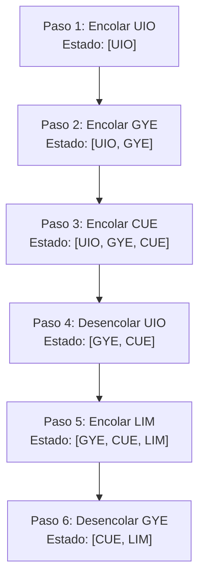
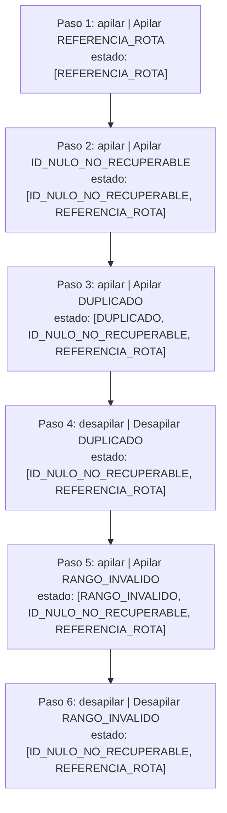
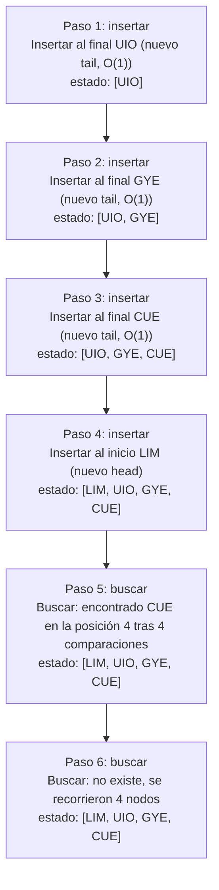
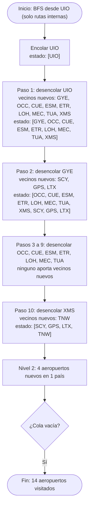
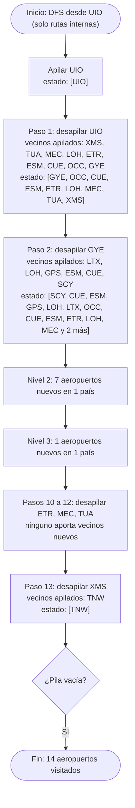

# Documentación generada por SmartETL-DS

Generada el 2026-11-19 08:53 a partir de ejecuciones reales. Cada diagrama tiene su página con zoom (`ver_*.html`).

## Flujograma ETL

*Generado por la API de IA.* Coherencia: el diagrama contiene todos los pasos esperados del registro y no agrega aeropuertos. Ver con zoom: [ver_flujo_etl.html](ver_flujo_etl.html)

```mermaid
flowchart TD
    A["Inicio del ETL<br/>Extract a Cola, Transform a Lista de válidos y Pila de errores"] --> B["Extract lee airports.csv<br/>7698 líneas, 0 no leídas"]
    B --> C["7698 registros de aeropuertos<br/>encolados en la cola de extracción"]
    C --> D["Transform: Desencolar registros<br/>Validación de aeropuertos"]
    D --> E{"¿Registro válido?<br/>7698 válidos, 0 inválidos"}
    E -- "Sí" --> F["Lista de Válidos<br/>(Ej: 1 GKA, 2 MAG, 3 HGU)"]
    E -- "No" --> G["Pila de Errores"]
    F --> H["Transform de aeropuertos:<br/>7698 procesados, 7698 válidos, 0 inválidos"]
    H --> I["Creación de Índices:<br/>BST global por IATA (6071 nodos)<br/>y lista ordenada por ID"]
    I --> J["Extract lee routes.csv<br/>67663 líneas, 0 no leídas"]
    J --> K["67663 registros de rutas<br/>encolados en la cola de extracción"]
    K --> L["Transform: Desencolar registros<br/>Validación de rutas"]
    L --> M{"¿Registro válido?<br/>67074 válidos, 589 inválidos"}
    M -- "Sí" --> N["Lista de Válidos<br/>(Ej: 2B AER-KZN, ASF-KZN, ASF-MRV)"]
    M -- "No" --> O["Pila de Errores<br/>(Ej: REFERENCIA_ROTA, ID_NULO)"]
    N --> P["Transform de rutas:<br/>67663 procesados, 67074 válidos,<br/>589 inválidos (REFERENCIA_ROTA 473, ID_NULO 116)"]
    O --> P
    P --> Q["Extract lee airlines.csv<br/>6162 líneas, 0 no leídas"]
    Q --> R["6162 registros de aerolíneas<br/>encolados en la cola de extracción"]
    R --> S["Transform: Desencolar registros<br/>Validación de aerolíneas"]
    S --> T{"¿Registro válido?<br/>6162 válidos, 0 inválidos"}
    T -- "Sí" --> U["Lista de Válidos<br/>(Ej: -1 Unknown, 1 Private, 2 135 Airways)"]
    T -- "No" --> V["Pila de Errores"]
    U --> W["Transform de aerolíneas:<br/>6162 procesados, 6162 válidos, 0 inválidos"]
    W --> X["Load / Fin del Transform:<br/>80934 válidos en listas y 589 errores en la pila<br/>Escritura de archivos limpios"]
```

## Flujograma cola

*Generado por la API de IA.* Coherencia: el diagrama contiene todos los pasos esperados del registro y no agrega aeropuertos. Ver con zoom: [ver_flujo_cola.html](ver_flujo_cola.html)

## Flujograma pila

*Generado por la API de IA.* Coherencia: el diagrama contiene todos los pasos esperados del registro y no agrega aeropuertos. Ver con zoom: [ver_flujo_pila.html](ver_flujo_pila.html)

## Flujograma lista

*Generado por la API de IA.* Coherencia: el diagrama contiene todos los pasos esperados del registro y no agrega aeropuertos. Ver con zoom: [ver_flujo_lista.html](ver_flujo_lista.html)

## Flujograma bst

*Generado por la API de IA.* Coherencia: el diagrama contiene todos los pasos esperados del registro y no agrega aeropuertos. Ver con zoom: [ver_flujo_bst.html](ver_flujo_bst.html)

```mermaid
flowchart TD
    P1["Paso 1: insertar<br/>Insertar MEX: el árbol estaba vacío, queda como raíz<br/>nodos en el árbol: 1"]
    P2["Paso 2: insertar<br/>Insertar GYE como hoja tras 1 comparaciones<br/>camino: MEX (izquierda), GYE (encontrado)<br/>nodos en el árbol: 2"]
    P3["Paso 3: insertar<br/>Insertar UIO como hoja tras 1 comparaciones<br/>camino: MEX (derecha), UIO (encontrado)<br/>nodos en el árbol: 3"]
    P4["Paso 4: insertar<br/>Insertar BOG como hoja tras 2 comparaciones<br/>camino: MEX (izquierda), GYE (izquierda), BOG (encontrado)<br/>nodos en el árbol: 4"]
    P5["Paso 5: insertar<br/>Insertar LIM como hoja tras 2 comparaciones<br/>camino: MEX (izquierda), GYE (derecha), LIM (encontrado)<br/>nodos en el árbol: 5"]
    P6["Paso 6: insertar<br/>Insertar SCL como hoja tras 2 comparaciones<br/>camino: MEX (derecha), UIO (izquierda), SCL (encontrado)<br/>nodos en el árbol: 6"]
    P7["Paso 7: insertar<br/>Insertar CUE como hoja tras 3 comparaciones<br/>camino: MEX (izquierda), GYE (izquierda), BOG (derecha), CUE (encontrado)<br/>nodos en el árbol: 7"]
    P8["Paso 8: buscar<br/>Buscar LIM: encontrado tras 3 comparaciones<br/>camino: MEX (izquierda), GYE (derecha), LIM (encontrado)<br/>nodos en el árbol: 7"]
    P9["Paso 9: eliminar<br/>Eliminar GYE (caso: dos hijos, se reemplaza por el sucesor inorden LIM)<br/>nodos en el árbol: 6"]
    P10["Paso 10: buscar<br/>Buscar CUE: encontrado tras 4 comparaciones<br/>camino: MEX (izquierda), LIM (izquierda), BOG (derecha), CUE (encontrado)<br/>nodos en el árbol: 6"]
    P1 --> P2
    P2 --> P3
    P3 --> P4
    P4 --> P5
    P5 --> P6
    P6 --> P7
    P7 --> P8
    P8 --> P9
    P9 --> P10
```

## Flujograma BFS

*Generado por la API de IA.* Coherencia: el diagrama contiene todos los pasos esperados del registro y no agrega aeropuertos. Ver con zoom: [ver_flujo_bfs.html](ver_flujo_bfs.html)

## Flujograma DFS

*Generado por la API de IA.* Coherencia: el diagrama contiene todos los pasos esperados del registro y no agrega aeropuertos. Ver con zoom: [ver_flujo_dfs.html](ver_flujo_dfs.html)

## Explicar árbol

*Generado por el respaldo local (sin IA).*

Respaldo local (sin IA). Datos reales usados:

BST global de aeropuertos con clave IATA (comparación de texto).
Nodos: 6071
Altura (raíz sola = 0): 177
Promedio de comparaciones de una búsqueda exitosa: 19,32
Primeros niveles (nodo e hijos izquierdo y derecho):
  Nivel 0 (1 nodos): GKA (izq AEY, der MAG)
  Nivel 1 (2 nodos): AEY (izq AAE, der EGS); MAG (izq HGU, der POM)
  Nivel 2 (4 nodos): AAE (izq AAA, der ACC); EGS (izq BUJ, der GJL); HGU (izq GOH, der LAE); POM (izq PFJ, der WWK)
  Nivel 3 (8 nodos): AAA (izq -, der AAC); ACC (izq ABJ, der ACI); BUJ (izq BJA, der DJG); GJL (izq ELG, der GJM); GOH (izq GLO, der HFN); LAE (izq HZK, der LOO); PFJ (izq MZW, der PHC); WWK (izq UAK, der YAM)
Búsqueda de UIO: encontrado a profundidad 12, 13 comparaciones
Camino: GKA (derecha) -> MAG (derecha) -> POM (derecha) -> WWK (izquierda) -> UAK (derecha) -> VEY (izquierda) -> URD (izquierda) -> UME (izquierda) -> ULD (izquierda) -> UGO (derecha) -> UIP (izquierda) -> UHE (derecha) -> UIO (encontrado)
La misma búsqueda en la lista de aeropuertos en orden del archivo costó 2556 comparaciones.
Un árbol perfectamente balanceado con esos nodos tendría altura 12.

## Explicar grafo de Ecuador

*Generado por la API de IA.*

Bienvenidos a nuestra clase de Estructuras de Datos. Hoy aplicaremos el concepto de grafos a un escenario real: la red de transporte aéreo de Ecuador. En este modelo, el grafo es **dirigido**, lo que significa que las conexiones tienen un sentido específico. Está formado exactamente por 14 vértices que representan a los aeropuertos del país que poseen al menos una ruta válida, y sus aristas representan las rutas únicas de origen a destino.

Las aristas internas conectan aeropuertos dentro del mismo territorio nacional, sumando un total de 32 rutas internas. Aquí destacan nodos principales como UIO (Quito) con 9 salidas internas y GYE (Guayaquil) con 7, seguidos por otros con menor flujo como OCC (Coca), ESM (Esmeraldas) y CUE (Cuenca). Por otro lado, las rutas externas modelan la conectividad internacional del grafo, con 26 rutas que salen hacia países como Colombia, Estados Unidos, España, Perú y Panamá, entre otros, y 27 rutas que llegan desde el exterior.

Para cerrar, recuerden que los algoritmos que estudiamos, como DFS (Búsqueda en Profundidad), nos permiten analizar la conectividad y encontrar patrones en estas estructuras. Al aplicar DFS en nuestro grafo ecuatoriano, es perfectamente posible detectar ciclos de rutas, como el recorrido cerrado que conecta `GYE -> UIO -> OCC -> LTX -> GYE`. ¡Anoten esto para el laboratorio de la próxima semana!

## Analizar errores ETL

*Generado por la API de IA.*

Hola, muchachos. Analizando los conteos agregados del proceso ETL sobre OpenFlights para nuestras estructuras de datos, vemos que los bloques de aeropuertos y aerolíneas tienen una calidad impecable, con 7698 y 6162 registros válidos respectivamente y cero errores. Esto significa que la carga base de entidades maestras está completa y sin duplicados ni campos obligatorios faltantes.

Sin embargo, el bloque de rutas presenta problemas en la integración. De 67663 rutas procesadas, 589 resultaron inválidas, y todos estos errores se concentran en dos categorías: 473 casos de `REFERENCIA_ROTA` y 116 casos de `ID_NULO_NO_RECUPERABLE`. No hubo fallas de formato, rangos ni duplicados; el problema radica exclusivamente en cómo se relacionan las rutas con los aeropuertos.

La regla `REFERENCIA_ROTA` detecta esos 473 errores porque el identificador del aeropuerto asociado a la ruta simplemente no existe en la tabla de aeropuertos, lo que rompe la integridad referencial del grafo de vuelos. Por su parte, la regla `ID_NULO_NO_RECUPERABLE` identifica los 116 casos donde el ID venía como nulo (`\N`) y el algoritmo falló al buscar el código IATA correspondiente dentro del BST (Árbol Binario de Búsqueda). Esto último nos enseña que, aunque algunos IDs nulos sí pudieron rescatarse consultando el BST, estos 116 registros no tenían salvación porque su código tampoco habitaba en nuestra estructura en memoria.

