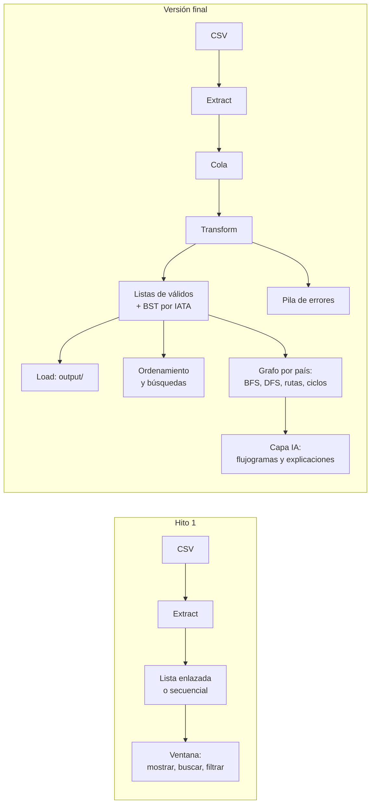
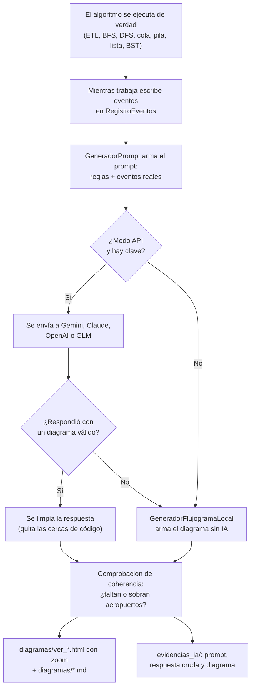
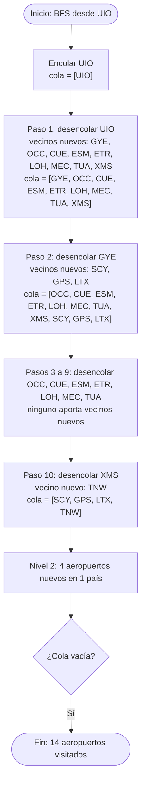

# SmartETL-DS: recorrido paso a paso

Este documento explica tres cosas:

1. Qué cambió entre el Hito 1 y la versión final, y qué se construyó con ayuda de IA.
2. Cómo ejecutar el programa y qué se ve en cada pestaña.
3. Qué hace por dentro la capa de IA del programa, con un ejemplo real.

---

## 1. Antes y ahora

### Tamaño del código

| | Hito 1 (zip original) | Versión final |
|---|---|---|
| Archivos `.java` | 21 | 73 |
| Líneas de código | 1.766 | 8.033 |
| Paquetes | model, estructuras, etl, app, pruebas | + algoritmos, grafo, ia |
| Pestañas de la ventana | 1 (Datos) | 5 (Datos, ETL, Estructuras, Grafo, IA) |
| Pruebas | 53 verificaciones | 198 verificaciones en 5 programas |

### Qué hace cada versión



| Tema | Hito 1 | Versión final |
|---|---|---|
| Datos | Se leían y se mostraban crudos | Se validan, se limpian, se separan en válidos y errores, y se escriben en `output/` |
| Errores | No se detectaban | 6 tipos en una **pila**: 589 errores reales en rutas |
| Búsqueda | Solo secuencial (UIO: 2.556 comparaciones) | Secuencial, binaria (13) y BST (13), comparadas lado a lado |
| Ordenamiento | No había | Burbuja e inserción, con comparaciones y tiempo |
| Árbol | No había | BST por IATA (6.071 nodos), BST de IDs para duplicados, BST de países |
| Grafo | No había | 225 países, 37.110 rutas únicas, BFS, DFS, ruta más corta, ciclos |
| Diagramas | Escritos a mano en `diagramas/Diagrama.md` | Generados desde la ejecución real, con zoom y comprobación de coherencia |
| IA | No había | Gemini, Claude, OpenAI o GLM, con respaldo local sin internet |

**Lo que no cambió:** las clases del Hito 1 conservan sus métodos públicos, y `PruebasHito1` sigue pasando sus 53 verificaciones. Solo se agregaron métodos nuevos, por ejemplo `primerNodo()` en la lista enlazada y `extraerEnCola()` en Extract. Lo que tenía la ventana se movió tal cual a la pestaña **Datos**.

### Qué se construyó con ayuda de IA (Claude Code)

El código de los hitos 2 a 5 lo escribió un asistente de IA siguiendo la especificación `CLAUDE.md`, que decidió el dueño del proyecto. Se trabajó por fases y cada fase se cerró compilando y pasando sus pruebas:

| Fase | Qué se hizo | Cómo se comprobó |
|---|---|---|
| 1. ETL | Cola, Pila, Transform, Load, ordenamiento, búsqueda binaria, archivos sucios | `PruebasHito2`: reproduce las cifras de la sección 4.5 (589 errores, 67.074 rutas válidas…) |
| 2. BST y grafos | ArbolBST, grafos por país, BFS, DFS, rutas, ciclos | `PruebasHito3` y `PruebasHito4`: altura 177, Ecuador 14/32/26/27, UIO→CUZ en 2 vuelos |
| 3. IA | Registro de eventos, generador local, clientes de API, coherencia, evidencias, HTML | `PruebasIA`; el flujograma BFS de Ecuador sale igual al ejemplo de la especificación |
| 4. Visualización | Visor interactivo del grafo, imagen con mermaid.ink | Probado en el navegador: nivel 1 = 23 aeropuertos, nivel 2 = 548, aviso al pasar de 2.000 |
| 5. Cierre | README, guion de demo, guía de defensa | |
| Ajustes pedidos después | Botón **Validar API**, mensajes de progreso ("Conectando con la API…") | Se pulsaron los botones por código y se leyó la barra de estado |

Decisiones que se apartan un poco de la especificación (cada una tiene su motivo):

- **Aeropuertos sin IATA en el grafo.** Se incluyen si tienen rutas, etiquetados con su código ICAO. Sin ellos, las cifras de referencia no cuadran: saldrían 17.450 pares internos en vez de 17.587 y 549 vértices en EE. UU. en vez de 550.
- **`data/demo/routes_sucio.csv`.** Se agregó junto al de aeropuertos, porque sin rutas no se pueden mostrar los dos tipos de error de rutas.
- **Países grandes en el drill-down.** EE. UU. se dibuja como árbol BFS desde el aeropuerto elegido, porque con todas sus aristas Mermaid tardaba más de 45 segundos.

**Importante para la defensa:** el docente puede pedir explicar o modificar cualquier parte. La guía [GUIA-DEFENSA.md](GUIA-DEFENSA.md) tiene, para cada estructura, lo que hay que decir, una traza a mano con datos reales y la pregunta más probable con su respuesta.

---

## 2. Cómo ejecutar, paso a paso

### Paso 1: abrir una terminal en la raíz del proyecto

La raíz es la carpeta `SmartETL_DS-main`, la que contiene `src`, `data` y `recursos`. En `cmd`:

```
cd "C:\Users\JC\Desktop\Tercer_Semestre\Estructura de Datos\Parcial2\SmartETL\SmartETL_DS-main"
```

### Paso 2: compilar

```
javac -encoding UTF-8 -d out src\model\*.java src\estructuras\*.java src\etl\*.java src\algoritmos\*.java src\grafo\*.java src\ia\*.java src\app\*.java src\pruebas\*.java
```

Si no imprime nada, compiló bien. Las clases compiladas quedan en `out\`.

### Paso 3: correr las pruebas (opcional, unos 30 segundos)

```
chcp 65001
java -Dfile.encoding=UTF-8 -cp out pruebas.PruebasHito1
java -Dfile.encoding=UTF-8 -cp out pruebas.PruebasHito2
java -Dfile.encoding=UTF-8 -cp out pruebas.PruebasHito3
java -Dfile.encoding=UTF-8 -cp out pruebas.PruebasHito4
java -Dfile.encoding=UTF-8 -cp out pruebas.PruebasIA
```

Cada una termina con `fallaron: 0`.

### Paso 4: abrir la ventana

```
java -cp out app.Main
```

En IntelliJ también se puede: clic derecho en `src/app/Main.java` y luego **Run**.

---

## 3. Recorrido por la ventana

Mientras algo se procesa, la barra de abajo muestra `⏳ mensaje... N s`. Al terminar muestra el resultado.

### Pestaña ETL

| Acción | Qué se ve |
|---|---|
| **Ejecutar ETL (datos reales)** | Mensajes: "Extract: leyendo airports.csv…", "Transform de rutas: validando 67663 registros…". Al final, tres columnas: la **cola** de extracción (primeros 20), las **listas de válidos** y la **pila de errores** (la cima arriba). Abajo, los contadores por tipo |
| **Cargar** | Crea en `output/` los archivos `airports_limpios.csv`, `routes_limpias.csv`, `airlines_limpias.csv`, `errores_etl.txt` y `reporte_etl.txt` |
| **Ejecutar demostración** | Usa `data/demo/` y en los contadores aparecen los 6 tipos de error |

### Pestaña Estructuras

| Acción | Qué se ve |
|---|---|
| Ordenar (Burbuja o Inserción, campo País) | Comparaciones, intercambios o desplazamientos, milisegundos y los primeros 15 resultados |
| Comparar búsquedas con `UIO` | Una tabla: lista 2.556, binaria 13, BST 13 comparaciones, cada una con su tiempo, más el camino en el BST |
| Construir, luego Altura y nodos | 6.071 nodos, altura 177, promedio 19,3 y los primeros niveles del árbol |
| Insertar, Buscar, Eliminar (con un IATA) | El camino recorrido y cómo cambian los nodos y la altura |
| Desbalance | El BST por ID con 1.500 aeropuertos tiene altura 1.499: se volvió una lista |

### Pestaña Grafo

| Acción | Qué se ve |
|---|---|
| Elegir Ecuador y pulsar **Construir seleccionados** | Ecuador: 14 aeropuertos, 32 rutas internas, 26 salen, 27 llegan |
| **BFS** desde UIO | Aeropuertos por nivel (0, 1 y 2) y el tiempo. El registro de eventos queda listo para la pestaña IA |
| **DFS** desde UIO | Orden de visita con la profundidad de cada aeropuerto |
| Buscar ruta UIO → CUZ | UIO → LIM → CUZ, 2 vuelos |
| Detectar ciclo en Ecuador | GYE → UIO → OCC → LTX → GYE |
| Diagrama general con clic por país | Se abre en el navegador; clic en un país para ver su grafo |
| Abrir visor interactivo | Página con niveles 1 a 8, filtro por países, búsqueda y clic para expandir |

### Pestaña IA

1. Elegir el **proveedor**, escribir el **modelo** y la **clave** (o dejar que se cargue de la variable de entorno).
2. Pulsar **Validar API** y esperar el indicador verde. Si queda en rojo, el texto dice el motivo.
3. Pulsar una función, por ejemplo **Flujograma BFS**.
4. Revisar el resultado: el código Mermaid, si lo generó la API o el respaldo, y la línea de coherencia.
5. Pulsar **Ver diagrama** para abrir el HTML con zoom en el navegador.

---

## 4. Qué hace la capa de IA por dentro

### El flujo completo



**La idea clave:** la IA no recorre el grafo ni ordena nada. Las estructuras propias hacen el trabajo y la IA solo recibe lo que quedó registrado, para convertirlo en un diagrama o en una explicación.

### Ejemplo real: BFS desde UIO dentro de Ecuador

**1. Lo que el BFS registró** (parte del prompt que se envía):

```
inicio | Inicio: BFS desde UIO (solo rutas internas) | nivel 0
encolar | Encolar UIO | nivel 0 | estado: [UIO]
desencolar | Paso 1: desencolar UIO | nivel 0 | vecinos nuevos: GYE, OCC, CUE, ESM, ETR, LOH, MEC, TUA, XMS | estado: [GYE, OCC, CUE, ...]
desencolar | Paso 2: desencolar GYE | nivel 1 | vecinos nuevos: SCY, GPS, LTX | estado: [OCC, CUE, ...]
desencolar | Paso 3: desencolar OCC | nivel 1 | estado: [CUE, ESM, ...]
...
Resumen calculado por el programa para los niveles profundos:
- Nivel 2: 4 aeropuertos nuevos en 1 país
```

**2. Las reglas que acompañan al prompt:** responder en español, devolver solo un bloque Mermaid que empiece con `flowchart TD`, poner las etiquetas entre comillas dobles, usar `<br/>` para los saltos de línea, colapsar los pasos sin vecinos nuevos y no inventar datos.

**3. El diagrama que se obtiene** (el respaldo local produce exactamente esto; la IA debe producir algo equivalente):



**4. La comprobación de coherencia.** El programa sabe, por el registro, que debían aparecer UIO, GYE, OCC, CUE, ESM, ETR, LOH, MEC, TUA y XMS (los niveles 0 y 1). Busca esos códigos en el diagrama y muestra el resultado:

- Si están todos y no aparece ningún código que no estuviera en el registro: "Coherencia: el diagrama contiene todos los pasos esperados…".
- Si a la IA se le olvidó GYE y agregó MIA: "Coherencia: faltan: GYE | sobran: MIA".

La comprobación no bloquea: solo informa.

**5. La evidencia.** Cada llamada deja un archivo como `evidencias_ia/20261109_101530_123_Flujograma_BFS.md` con la fecha, el proveedor, el modelo, el prompt completo, la respuesta cruda y el diagrama final. La clave nunca se guarda.

### IA en vivo frente al respaldo local

| | API en vivo | Respaldo local |
|---|---|---|
| Necesita internet y clave | Sí | No |
| Entrada | El mismo registro de eventos | El mismo registro de eventos |
| Diagrama | Lo redacta la IA: puede variar el texto o el orden de las cajas | Siempre igual, siguiendo las reglas de la sección 7.4 |
| Explicaciones (árbol, grafo, errores) | Texto redactado en 2 a 4 párrafos | Los datos reales en forma de lista |
| Coherencia | Se verifica, porque la IA se puede equivocar | Se verifica igual (siempre sale completa) |
| Evidencia | Sí, en `evidencias_ia/` | No, porque no hubo llamada |

Si la API falla a mitad de la demo, el programa avisa ("La API falló…: usando el respaldo local") y el diagrama sale igual. Por eso la presentación no depende de internet.

### Las 8 funciones de la pestaña IA

| Botón | Qué datos reales usa | Qué devuelve |
|---|---|---|
| Flujograma ETL | Eventos de la última ejecución del ETL (archivos, totales, ejemplos de errores) | Diagrama |
| Flujograma Cola, Pila, Lista enlazada, BST | Una traza corta que se ejecuta en ese momento con la estructura propia | Diagrama |
| Flujograma BFS y Flujograma DFS | Eventos del último BFS o DFS de la pestaña Grafo (si no hubo ninguno, corre uno desde UIO) | Diagrama |
| Explicar árbol | Nodos, altura, primeros niveles y camino de UIO del BST | Texto |
| Explicar grafo | Vértices, rutas internas y externas por país del último país usado | Texto |
| Analizar errores ETL | Solo conteos por tipo y fuente | Texto |
| Generar documentación | Todo lo anterior | `diagramas/DOCUMENTACION.md` y las páginas `ver_*.html` |
