# Evidencia de IA: Flujograma ETL

- Fecha y hora: 2026-11-14 03:09:15
- Proveedor: Gemini
- Modelo: (no indicado)
- Se usó el respaldo local: sí
- Notas: La API no respondió bien (no hay clave de API). Se usó el respaldo local. | Coherencia: el diagrama contiene todos los pasos esperados del registro y no agrega aeropuertos.

## Prompt enviado

````text
Eres un asistente que dibuja flujogramas para un curso de Estructuras de Datos.
Genera el flujograma del proceso ETL (Extract, Transform, Load) que se ejecutó realmente.
Extract lee cada CSV y encola los registros en una Cola; Transform desencola, valida y manda cada registro a la Lista de válidos o a la Pila de errores; Load escribe los archivos limpios.

Reglas obligatorias:
- Responde en español.
- Devuelve SOLO un bloque de código Mermaid (```mermaid ... ```), sin texto antes ni después.
- La primera línea del diagrama debe ser: flowchart TD
- Pon cada etiqueta de nodo entre comillas dobles, por ejemplo A["texto"].
- Para saltos de línea dentro de una etiqueta usa <br/>.
- No inventes datos: usa solo los aeropuertos, números y pasos que aparecen en la entrada.
- Cada nodo debe corresponder a un paso real del registro de eventos.
- Para cada fuente dibuja la decisión ¿Registro válido? con las ramas Sí (lista) y No (pila) y las cifras reales.

Registro de eventos real:
1. inicio | Inicio del ETL: Extract a una Cola, Transform a Lista de válidos y Pila de errores
2. leer | Extract lee airports.csv: 7698 líneas, 0 no leídas | nivel 0
3. encolar | 7698 registros de aeropuertos encolados en la cola de extracción | nivel 0
4. valido | Desencolar línea 1 de aeropuertos: válido, pasa a la lista (1 GKA Goroka Airport) | nivel 0
5. valido | Desencolar línea 2 de aeropuertos: válido, pasa a la lista (2 MAG Madang Airport) | nivel 0
6. valido | Desencolar línea 3 de aeropuertos: válido, pasa a la lista (3 HGU Mount Hagen Kagamuga Airport) | nivel 0
7. totales | Transform de aeropuertos: 7698 procesados, 7698 válidos, 0 inválidos | nivel 0 | procesados, válidos, inválidos, por tipo: 7698, 7698, 0, 
8. indice | Índices: BST global por IATA con 6071 nodos y lista de aeropuertos ordenada por ID para búsqueda binaria
9. leer | Extract lee routes.csv: 67663 líneas, 0 no leídas | nivel 1
10. encolar | 67663 registros de rutas encolados en la cola de extracción | nivel 1
11. valido | Desencolar línea 1 de rutas: válido, pasa a la lista (2B AER-KZN (IDs 2965 -> 2990)) | nivel 1
12. valido | Desencolar línea 2 de rutas: válido, pasa a la lista (2B ASF-KZN (IDs 2966 -> 2990)) | nivel 1
13. valido | Desencolar línea 3 de rutas: válido, pasa a la lista (2B ASF-MRV (IDs 2966 -> 2962)) | nivel 1
14. invalido | Desencolar línea 171 de rutas: inválido, REFERENCIA_ROTA (El ID de destino 7167 no existe en airports), se apila en la pila de errores | nivel 1
15. invalido | Desencolar línea 172 de rutas: inválido, REFERENCIA_ROTA (El ID de destino 7168 no existe en airports), se apila en la pila de errores | nivel 1
16. invalido | Desencolar línea 174 de rutas: inválido, REFERENCIA_ROTA (El ID de destino 7164 no existe en airports), se apila en la pila de errores | nivel 1
17. invalido | Desencolar línea 175 de rutas: inválido, REFERENCIA_ROTA (El ID de destino 7163 no existe en airports), se apila en la pila de errores | nivel 1
18. invalido | Desencolar línea 176 de rutas: inválido, REFERENCIA_ROTA (El ID de origen 7167 no existe en airports), se apila en la pila de errores | nivel 1
19. totales | Transform de rutas: 67663 procesados, 67074 válidos, 589 inválidos (REFERENCIA_ROTA 473, ID_NULO_NO_RECUPERABLE 116) | nivel 1 | procesados, válidos, inválidos, por tipo: 67663, 67074, 589, REFERENCIA_ROTA 473, ID_NULO_NO_RECUPERABLE 116
20. leer | Extract lee airlines.csv: 6162 líneas, 0 no leídas | nivel 2
21. encolar | 6162 registros de aerolíneas encolados en la cola de extracción | nivel 2
22. valido | Desencolar línea 1 de aerolíneas: válido, pasa a la lista (-1 Unknown) | nivel 2
23. valido | Desencolar línea 2 de aerolíneas: válido, pasa a la lista (1 Private flight) | nivel 2
24. valido | Desencolar línea 3 de aerolíneas: válido, pasa a la lista (2 135 Airways) | nivel 2
25. totales | Transform de aerolíneas: 6162 procesados, 6162 válidos, 0 inválidos | nivel 2 | procesados, válidos, inválidos, por tipo: 6162, 6162, 0, 
26. fin_transform | Fin del Transform: 80934 válidos en listas y 589 errores en la pila

````

## Respuesta cruda

````text
(sin respuesta de la API)
````

## Resultado final

```mermaid
flowchart TD
    N0(["Inicio del ETL: Extract a una Cola, Transform a Lista de válidos y Pila de errores"])
    N1["EXTRACT<br/>Extract lee airports.csv: 7698 líneas, 0 no leídas"]
    N0 --> N1
    N2["Cola de extracción<br/>7698 registros de aeropuertos encolados en la cola de extracción"]
    N1 --> N2
    N3["TRANSFORM de aeropuertos<br/>desencolar cada registro y validar"]
    N2 --> N3
    N4{"¿Registro válido?"}
    N3 --> N4
    N5["Lista de válidos: 7698<br/>ej. 1 GKA Goroka Airport"]
    N6["Pila de errores: 0"]
    N4 -->|"Sí"| N5
    N4 -->|"No"| N6
    N7["Totales de aeropuertos: 7698 procesados, 7698 válidos, 0 inválidos"]
    N5 --> N7
    N6 --> N7
    N8["Índices: BST global por IATA con 6071 nodos y lista de aeropuertos ordenada por ID para búsqueda binaria"]
    N7 --> N8
    N9["EXTRACT<br/>Extract lee routes.csv: 67663 líneas, 0 no leídas"]
    N8 --> N9
    N10["Cola de extracción<br/>67663 registros de rutas encolados en la cola de extracción"]
    N9 --> N10
    N11["TRANSFORM de rutas<br/>desencolar cada registro y validar"]
    N10 --> N11
    N12{"¿Registro válido?"}
    N11 --> N12
    N13["Lista de válidos: 67074<br/>ej. 2B AER-KZN (IDs 2965 -> 2990)"]
    N14["Pila de errores: 589<br/>REFERENCIA_ROTA 473, ID_NULO_NO_RECUPERABLE 116"]
    N12 -->|"Sí"| N13
    N12 -->|"No"| N14
    N15["Totales de rutas: 67663 procesados, 67074 válidos, 589 inválidos"]
    N13 --> N15
    N14 --> N15
    N16["EXTRACT<br/>Extract lee airlines.csv: 6162 líneas, 0 no leídas"]
    N15 --> N16
    N17["Cola de extracción<br/>6162 registros de aerolíneas encolados en la cola de extracción"]
    N16 --> N17
    N18["TRANSFORM de aerolíneas<br/>desencolar cada registro y validar"]
    N17 --> N18
    N19{"¿Registro válido?"}
    N18 --> N19
    N20["Lista de válidos: 6162<br/>ej. -1 Unknown"]
    N21["Pila de errores: 0"]
    N19 -->|"Sí"| N20
    N19 -->|"No"| N21
    N22["Totales de aerolíneas: 6162 procesados, 6162 válidos, 0 inválidos"]
    N20 --> N22
    N21 --> N22
    N23["Fin del Transform: 80934 válidos en listas y 589 errores en la pila"]
    N22 --> N23
    N24(["Fin del Transform (falta pulsar Cargar para el Load)"])
    N23 --> N24
```


