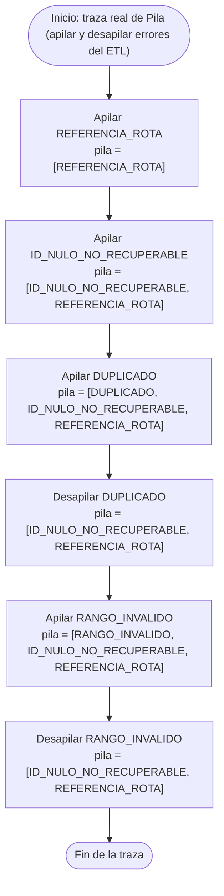

# Evidencia de IA: Flujograma pila

- Fecha y hora: 2026-11-16 09:18:07
- Proveedor: Gemini
- Modelo: gemini-3.6-flash
- Se usó el respaldo local: sí
- Notas: La API no respondió bien (request timed out). Se usó el respaldo local. | Coherencia: el diagrama contiene todos los pasos esperados del registro y no agrega aeropuertos.

## Prompt enviado

````text
Eres un asistente que dibuja flujogramas para un curso de Estructuras de Datos.
Genera el flujograma de esta traza real de operaciones sobre la estructura: Pila (apilar y desapilar errores del ETL).
Cada operación es una caja con el estado resultante de la estructura (o el camino recorrido en el árbol).

Reglas obligatorias:
- Responde en español.
- Devuelve SOLO un bloque de código Mermaid (```mermaid ... ```), sin texto antes ni después.
- La primera línea del diagrama debe ser: flowchart TD
- Pon cada etiqueta de nodo entre comillas dobles, por ejemplo A["texto"].
- Para saltos de línea dentro de una etiqueta usa <br/>.
- No inventes datos: usa solo los aeropuertos, números y pasos que aparecen en la entrada.
- Cada nodo debe corresponder a un paso real del registro de eventos.

Registro de eventos real:
1. apilar | Apilar REFERENCIA_ROTA | estado: [REFERENCIA_ROTA]
2. apilar | Apilar ID_NULO_NO_RECUPERABLE | estado: [ID_NULO_NO_RECUPERABLE, REFERENCIA_ROTA]
3. apilar | Apilar DUPLICADO | estado: [DUPLICADO, ID_NULO_NO_RECUPERABLE, REFERENCIA_ROTA]
4. desapilar | Desapilar DUPLICADO | estado: [ID_NULO_NO_RECUPERABLE, REFERENCIA_ROTA]
5. apilar | Apilar RANGO_INVALIDO | estado: [RANGO_INVALIDO, ID_NULO_NO_RECUPERABLE, REFERENCIA_ROTA]
6. desapilar | Desapilar RANGO_INVALIDO | estado: [ID_NULO_NO_RECUPERABLE, REFERENCIA_ROTA]

````

## Respuesta cruda

````text
(sin respuesta de la API)
````

## Resultado final


