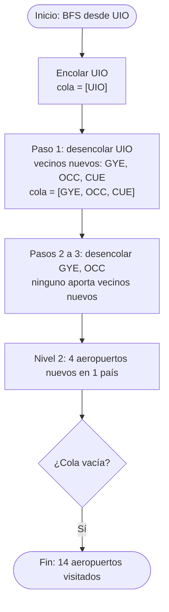
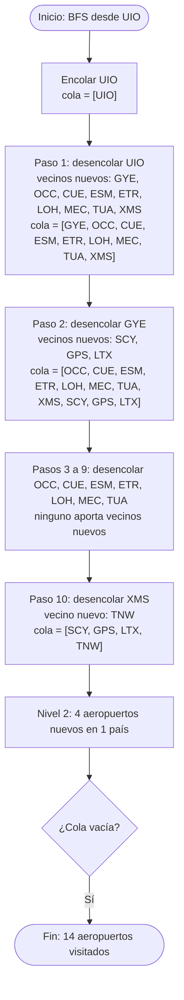

# Evidencia de IA: Flujograma BFS

- Fecha y hora: 2026-11-16 09:19:37
- Proveedor: Gemini
- Modelo: gemini-3.6-flash
- Se usó el respaldo local: sí
- Notas: La API no respondió bien (request timed out). Se usó el respaldo local. | Coherencia: el diagrama contiene todos los pasos esperados del registro y no agrega aeropuertos.

## Prompt enviado

````text
Eres un asistente que dibuja flujogramas de algoritmos para un curso de Estructuras de Datos.
Genera el flujograma del recorrido BFS (usa una cola) que se ejecutó realmente sobre el grafo de aeropuertos de OpenFlights.

Reglas obligatorias:
- Responde en español.
- Devuelve SOLO un bloque de código Mermaid (```mermaid ... ```), sin texto antes ni después.
- La primera línea del diagrama debe ser: flowchart TD
- Pon cada etiqueta de nodo entre comillas dobles, por ejemplo A["texto"].
- Para saltos de línea dentro de una etiqueta usa <br/>.
- No inventes datos: usa solo los aeropuertos, números y pasos que aparecen en la entrada.
- Cada nodo debe corresponder a un paso real del registro de eventos.
- Los pasos consecutivos sin vecinos nuevos se colapsan en una sola caja ("Pasos a a b: ...").
- Las listas de más de 12 elementos se muestran con los primeros 12 y "y N más".
- Detalla solo los pasos de nivel menor o igual a 1; los niveles más profundos van en una caja por nivel con el resumen dado.
- Termina con la decisión ¿Cola vacía? y el nodo de fin con el total de visitados.

Ejemplo del formato esperado (otros datos):


Registro de eventos real (tipo | texto | nivel | vecinos | estado de la estructura):
inicio | Inicio: BFS desde UIO (solo rutas internas) | nivel 0
encolar | Encolar UIO | nivel 0 | estado: [UIO]
desencolar | Paso 1: desencolar UIO | nivel 0 | vecinos nuevos: GYE, OCC, CUE, ESM, ETR, LOH, MEC, TUA, XMS | estado: [GYE, OCC, CUE, ESM, ETR, LOH, MEC, TUA, XMS]
desencolar | Paso 2: desencolar GYE | nivel 1 | vecinos nuevos: SCY, GPS, LTX | estado: [OCC, CUE, ESM, ETR, LOH, MEC, TUA, XMS, SCY, GPS, LTX]
desencolar | Paso 3: desencolar OCC | nivel 1 | estado: [CUE, ESM, ETR, LOH, MEC, TUA, XMS, SCY, GPS, LTX]
desencolar | Paso 4: desencolar CUE | nivel 1 | estado: [ESM, ETR, LOH, MEC, TUA, XMS, SCY, GPS, LTX]
desencolar | Paso 5: desencolar ESM | nivel 1 | estado: [ETR, LOH, MEC, TUA, XMS, SCY, GPS, LTX]
desencolar | Paso 6: desencolar ETR | nivel 1 | estado: [LOH, MEC, TUA, XMS, SCY, GPS, LTX]
desencolar | Paso 7: desencolar LOH | nivel 1 | estado: [MEC, TUA, XMS, SCY, GPS, LTX]
desencolar | Paso 8: desencolar MEC | nivel 1 | estado: [TUA, XMS, SCY, GPS, LTX]
desencolar | Paso 9: desencolar TUA | nivel 1 | estado: [XMS, SCY, GPS, LTX]
desencolar | Paso 10: desencolar XMS | nivel 1 | vecinos nuevos: TNW | estado: [SCY, GPS, LTX, TNW]
fin | Fin: 14 aeropuertos visitados | nivel 2

Resumen calculado por el programa para los niveles profundos:
- Nivel 2: 4 aeropuertos nuevos en 1 país

````

## Respuesta cruda

````text
(sin respuesta de la API)
````

## Resultado final


