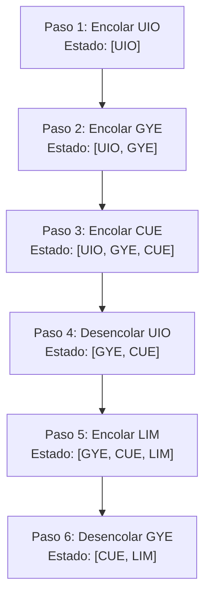

# Evidencia de IA: Flujograma cola

- Fecha y hora: 2026-11-19 08:52:06
- Proveedor: Gemini
- Modelo: gemini-3.5-flash-lite
- Se usó el respaldo local: no
- Notas: Respuesta de Gemini (gemini-3.5-flash-lite). | Coherencia: el diagrama contiene todos los pasos esperados del registro y no agrega aeropuertos.

## Prompt enviado

````text
Eres un asistente que dibuja flujogramas para un curso de Estructuras de Datos.
Genera el flujograma de esta traza real de operaciones sobre la estructura: Cola (encolar y desencolar aeropuertos).
Cada operación es una caja con el estado resultante de la estructura (o el camino recorrido en el árbol).

Reglas obligatorias:
- Responde en español.
- Devuelve SOLO un bloque de código Mermaid (```mermaid ... ```), sin texto antes ni después.
- La primera línea del diagrama debe ser: flowchart TD
- Pon cada etiqueta de nodo entre comillas dobles, por ejemplo A["texto"].
- Para saltos de línea dentro de una etiqueta usa <br/>.
- No inventes datos: usa solo los aeropuertos, números y pasos que aparecen en la entrada.
- Cada nodo debe corresponder a un paso real del registro de eventos.

Registro de eventos real:
1. encolar | Encolar UIO | estado: [UIO]
2. encolar | Encolar GYE | estado: [UIO, GYE]
3. encolar | Encolar CUE | estado: [UIO, GYE, CUE]
4. desencolar | Desencolar UIO | estado: [GYE, CUE]
5. encolar | Encolar LIM | estado: [GYE, CUE, LIM]
6. desencolar | Desencolar GYE | estado: [CUE, LIM]

````

## Respuesta cruda

````text

````

## Resultado final


