```mermaid
flowchart TD
    P1["Paso 1: insertar<br/>Insertar MEX: el árbol estaba vacío, queda como raíz<br/>nodos en el árbol: 1"]
    P2["Paso 2: insertar<br/>Insertar GYE como hoja tras 1 comparaciones<br/>camino: MEX (izquierda), GYE (encontrado)<br/>nodos en el árbol: 2"]
    P3["Paso 3: insertar<br/>Insertar UIO como hoja tras 1 comparaciones<br/>camino: MEX (derecha), UIO (encontrado)<br/>nodos en el árbol: 3"]
    P4["Paso 4: insertar<br/>Insertar BOG como hoja tras 2 comparaciones<br/>camino: MEX (izquierda), GYE (izquierda), BOG (encontrado)<br/>nodos en el árbol: 4"]
    P5["Paso 5: insertar<br/>Insertar LIM como hoja tras 2 comparaciones<br/>camino: MEX (izquierda), GYE (derecha), LIM (encontrado)<br/>nodos en el árbol: 5"]
    P6["Paso 6: insertar<br/>Insertar SCL como hoja tras 2 comparaciones<br/>camino: MEX (derecha), UIO (izquierda), SCL (encontrado)<br/>nodos en el árbol: 6"]
    P7["Paso 7: insertar<br/>Insertar CUE como hoja tras 3 comparaciones<br/>camino: MEX (izquierda), GYE (izquierda), BOG (derecha), CUE (encontrado)<br/>nodos en el árbol: 7"]
    P8["Paso 8: buscar<br/>Buscar LIM: encontrado tras 3 comparaciones<br/>camino: MEX (izquierda), GYE (derecha), LIM (encontrado)<br/>nodos en el árbol: 7"]
    P9["Paso 9: eliminar<br/>Eliminar GYE (caso: dos hijos, se reemplaza por el sucesor inorden LIM)<br/>nodos en el árbol: 6"]
    P10["Paso 10: buscar<br/>Buscar CUE: encontrado tras 4 comparaciones<br/>camino: MEX (izquierda), LIM (izquierda), BOG (derecha), CUE (encontrado)<br/>nodos en el árbol: 6"]

    P1 --> P2
    P2 --> P3
    P3 --> P4
    P4 --> P5
    P5 --> P6
    P6 --> P7
    P7 --> P8
    P8 --> P9
    P9 --> P10
```

# Evidencia de IA: Flujograma bst

- Fecha y hora: 2026-11-19 08:52:38
- Proveedor: Gemini
- Modelo: gemini-3.5-flash-lite
- Se usó el respaldo local: no
- Notas: Respuesta de Gemini (gemini-3.5-flash-lite). | Coherencia: el diagrama contiene todos los pasos esperados del registro y no agrega aeropuertos.

## Prompt enviado

````text
Eres un asistente que dibuja flujogramas para un curso de Estructuras de Datos.
Genera el flujograma de esta traza real de operaciones sobre la estructura: BST por IATA (insertar, buscar y eliminar).
Cada operación es una caja con el estado resultante de la estructura (o el camino recorrido en el árbol).

Reglas obligatorias:
- Responde en español.
- Devuelve SOLO un bloque de código Mermaid (```mermaid ... ```), sin texto antes ni después.
- La primera línea del diagrama debe ser: flowchart TD
- Pon cada etiqueta de nodo entre comillas dobles, por ejemplo A["texto"].
- Para saltos de línea dentro de una etiqueta usa <br/>.
- No inventes datos: usa solo los aeropuertos, números y pasos que aparecen en la entrada.
- Cada nodo debe corresponder a un paso real del registro de eventos.

Registro de eventos real:
1. insertar | Insertar MEX: el árbol estaba vacío, queda como raíz | nodos en el árbol: 1
2. insertar | Insertar GYE como hoja tras 1 comparaciones | camino: MEX (izquierda), GYE (encontrado) | nodos en el árbol: 2
3. insertar | Insertar UIO como hoja tras 1 comparaciones | camino: MEX (derecha), UIO (encontrado) | nodos en el árbol: 3
4. insertar | Insertar BOG como hoja tras 2 comparaciones | camino: MEX (izquierda), GYE (izquierda), BOG (encontrado) | nodos en el árbol: 4
5. insertar | Insertar LIM como hoja tras 2 comparaciones | camino: MEX (izquierda), GYE (derecha), LIM (encontrado) | nodos en el árbol: 5
6. insertar | Insertar SCL como hoja tras 2 comparaciones | camino: MEX (derecha), UIO (izquierda), SCL (encontrado) | nodos en el árbol: 6
7. insertar | Insertar CUE como hoja tras 3 comparaciones | camino: MEX (izquierda), GYE (izquierda), BOG (derecha), CUE (encontrado) | nodos en el árbol: 7
8. buscar | Buscar LIM: encontrado tras 3 comparaciones | camino: MEX (izquierda), GYE (derecha), LIM (encontrado) | nodos en el árbol: 7
9. eliminar | Eliminar GYE (caso: dos hijos, se reemplaza por el sucesor inorden LIM) | nodos en el árbol: 6
10. buscar | Buscar CUE: encontrado tras 4 comparaciones | camino: MEX (izquierda), LIM (izquierda), BOG (derecha), CUE (encontrado) | nodos en el árbol: 6

````

## Respuesta cruda

````text

````

## Resultado final


